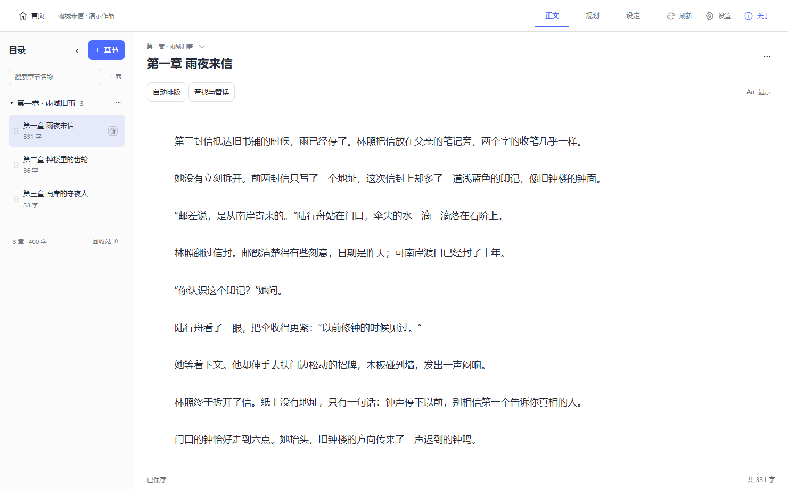
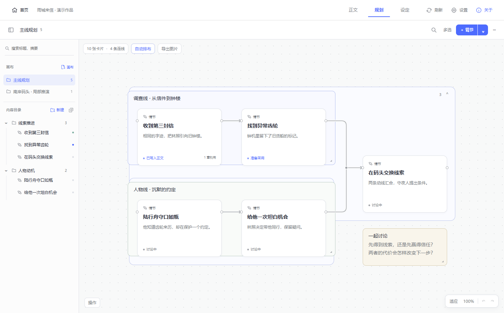
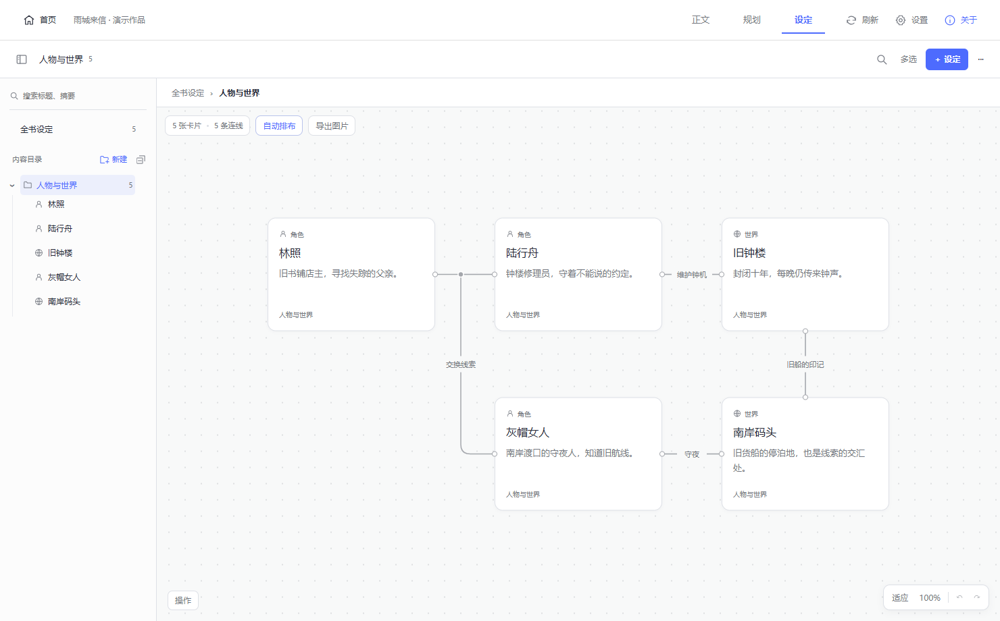

<div align="center">

<h1>催更姬</h1>
<p><strong>让大肥鱼成为你的小说写作助手</strong></p>
<p>写正文 · 推敲情节 · 整理人物与世界<br>在 DSH 里，和 AI 一起把故事写下去。</p>

<a href="https://www.bilibili.com/video/BV1e5HE6wErd/">
  
</a>

<p>
  <a href="docs/getting-started.md"><strong>开始使用</strong></a> ·
  <a href="https://www.bilibili.com/video/BV1e5HE6wErd/"><strong>看视频演示</strong></a> ·
  <a href="docs/agent-installation.md">交给 Agent 安装</a>
</p>

<p>
  <a href="https://github.com/mistnest/dsh-cuigengji-plugin/releases/latest"></a>
  <a href="https://www.npmjs.com/package/dsh-cuigengji-plugin"></a>
  <a href="LICENSE"></a>
</p>

</div>

**正文写到一半，想和 AI 商量下一步，却又得重新解释人物和前情。**

催更姬是 [DeepSeek Harness（DSH）](https://github.com/deepseek-ai/deepseek-harness) 的小说写作插件。把正文、情节规划、人物和世界设定放在同一个工作台里，让你和 AI 围着同一份作品资料讨论、续写和修改。

## 装进 DSH，开始写

使用 **DSH Windows 桌面版 0.2.0-rc.2 或更新版本**，无需另装 Git、Node.js 或编译源码。

1. 打开 DSH 的「插件 → 添加插件」。
2. 在「包名或地址」填入下方内容，「安装源」保持默认或选择 npm 官方源 / 中国大陆镜像源。
3. 安装后按提示重启，从左侧「催更姬」进入，创建或选择作品。

```text
dsh-cuigengji-plugin@0.4.5
```

请保留版本号，避免宿主将不带版本的包名解析到旧版。「安装源」用于下载依赖，保持为包源即可。

[详细安装步骤](docs/getting-started.md) · [备用成品包](https://github.com/mistnest/dsh-cuigengji-plugin/releases/download/v0.4.5/dsh-cuigengji-plugin-0.4.5.tgz) · [更新与数据迁移](docs/upgrade.md)

也可以把[安装与更新指南](docs/agent-installation.md)交给 Agent，由它处理安装、备份和升级检查。当前已实际验收 DSH **0.2.1-rc.2** 和 **0.2.0-rc.2**；更新插件会自动备份、迁移并校验原有作品。

## 从一个想法，到一部小说

### 写正文，随时和大肥鱼商量

在聊天旁边直接写稿。按卷、章节整理作品，自动保存、查看字数、调整顺序，写好的内容可以排版和复制；改得不满意，还能回看正文历史版本。



### 把情节摊开，一起推敲

把主角的行动、支线的交汇、尚未决定的走向放到画布上，用卡片、连线、讨论框和便签慢慢理清。大场面可以单独开一页推演，作者和 AI 都能维护这张图。



### 人物和世界，随用随查

把人物动机、关系、地点和世界规则整理成角色卡与世界书，支持分组、搜索和关系图。写到相关情节时，AI 可以查阅、补充这些资料，让后续推进有据可依。



*以上截图使用虚构演示作品。*

| 还有这些写作工具 | 能帮你做什么 |
| --- | --- |
| [每本作品的写作预设](docs/presets.md) | 保存文风、视角等写作要求，启用后提供给绑定作品的 AI 会话。 |
| [酒馆资料导入](docs/tavern-import.md) | 接着用已有的角色卡、世界书和提示词预设，导入后继续整理。 |
| [导入、导出与备份](docs/import-export.md) | 带走整本作品，或选择章节、设定分组、规划页与预设；也能备份整个工作库。 |

## 为什么正文之外，还需要这些资料？

一部小说像一座冰山。正文是读者看见的部分，水面之下，还有人物的动机、没揭开的伏笔、世界的规则，以及你对后续故事的安排。

催更姬给 AI 提供查阅和维护这些资料的工具，让讨论留下来，下次能接着推进。资料按需要读取，写作要求跟着作品走，帮助减少长篇创作中的人物变味、伏笔断掉和情节跑偏。

就像身边多了随时可以讨论的编辑：一起琢磨人物，推敲下一章怎么走。**故事由你做主，大肥鱼陪你写下去。**

## 交流与支持

- **QQ 交流群：1026457465**，欢迎分享作品体验、反馈问题和讨论后续功能。
- **[爱发电 · 支持催更姬](https://ifdian.net/a/cuigengji)**：欢迎合作与投喂，每一份支持都会化作 token，帮助催更姬继续成长。
- **[提交问题或建议](https://github.com/mistnest/dsh-cuigengji-plugin/issues)**：带上 DSH 与插件版本、操作步骤，更方便定位问题。

## 文档与开源

[使用文档](docs/README.md) · [更新记录](docs/CHANGELOG.md) · [源码与贡献](docs/development.md) · [架构说明](docs/architecture.md)

作品保存在独立的数据目录里，插件升级与源码更换不会把小说混进代码。实际位置可在「导入 / 导出」中查看，备份范围见[数据管理说明](docs/import-export.md)。

本仓库提供正式版源码、构建产物、使用文档与合成测试样例。源码采用 [MIT 许可证](LICENSE)；小说内容和自行导入的资料属于各自作者。
