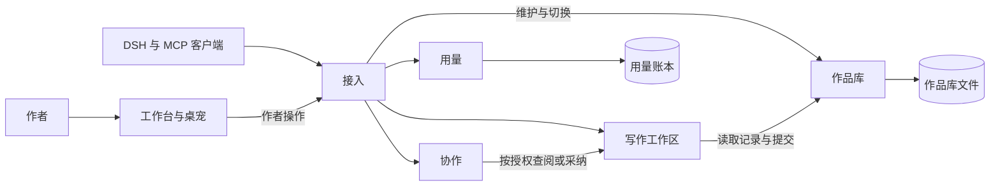
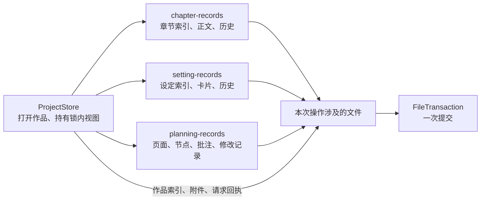
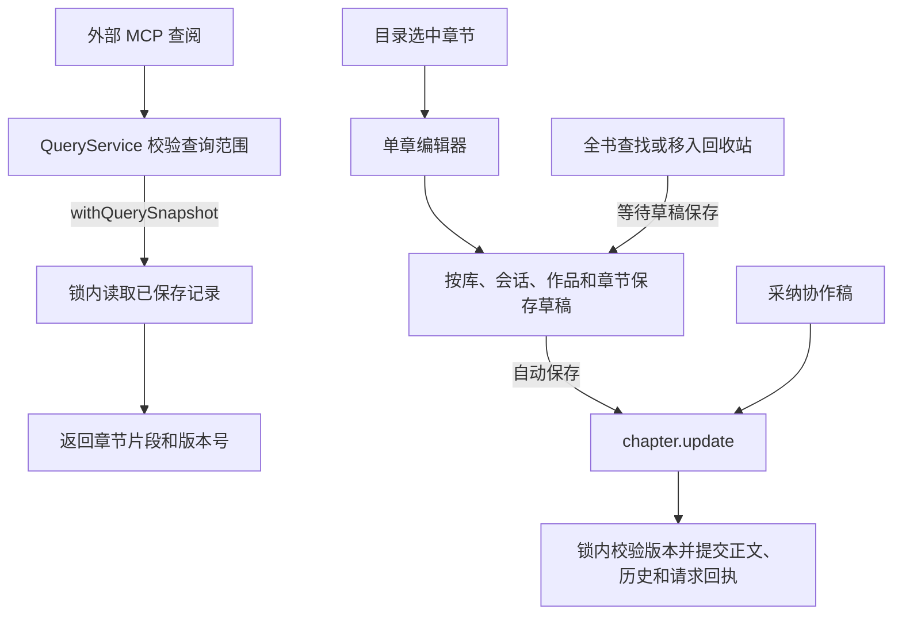
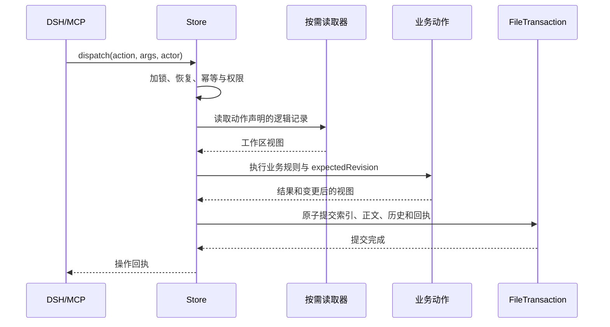
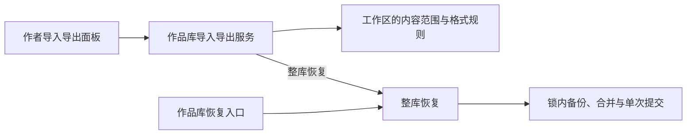
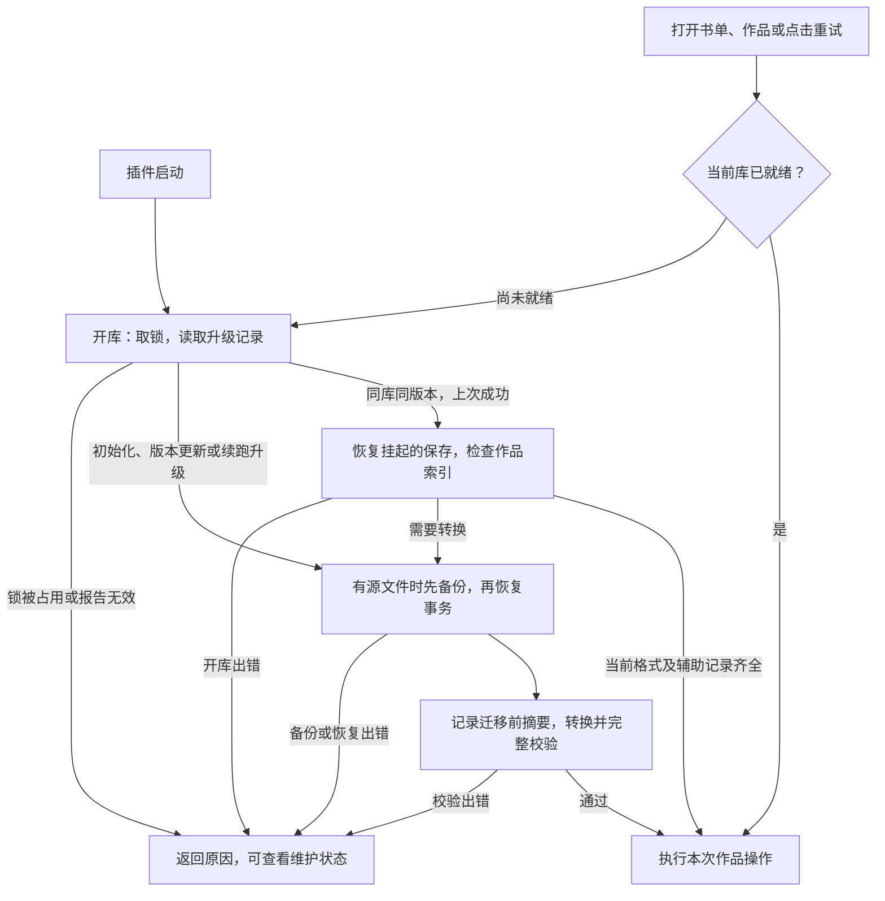

# 模块与数据存储

`src/` 是源码入口；`runtime/` 和 `lib/client.js` 为对应构建产物，随源码提交，供 DSH 直接安装。旧 `core`、`assistant`、`mcp` 路径保留兼容转发。普通用户安装不运行构建钩子。

## 模块边界

| 源码模块 | 维护范围 |
| --- | --- |
| `src/modules/author-ui/` | React 工作台和 Windows 桌宠。作者在这里打开、编辑和审阅内容 |
| `src/modules/access/` | DSH、RPC、MCP 和提示词接入。将宿主调用翻译为带身份的操作 |
| `src/modules/workspace/` | 作品、正文、设定、规划、预设、变量和写作记录。每个功能就近维护动作声明、业务规则与读写处理 |
| `src/modules/collaboration/` | 外部阅读授权、任务范围、提交和采纳。采纳通过作品原有的版本检查和保存流程 |
| `src/modules/usage/` | 独立的用量账本、价格、厂商余额与汇总 |
| `src/modules/library/` | 作品库的定位和切换、记录读写、文件布局、锁内提交和升级恢复 |

`src/index.ts` 注册插件，`src/composition/` 将具体服务组装到同一生命周期。`src/platform/` 提供文件锁、JSON 读取和错误处理等公共基础能力。组装后的 `composition/store.ts` 保留 `Store.dispatch` 入口。

## 模块如何协作



上图的箭头表示一次操作如何执行。源码里，作品库可以引用章节、设定等业务规则，工作区通过接口请求读写记录。两者在 `composition/` 组装。`npm run check:build` 同时检查实际编译出的前后端依赖，发现文件循环、模块循环或写作业务反向引用存储实现时会指出对应路径。

作品业务通过 `workspace/operations/record-reader.ts` 声明本次需要的记录。比如目录只需要章节索引，编辑一章还要读取该章正文和版本。版本冲突规则归 `workspace/chapters/`，文件读写归 `library/records/`。



三种记录各自跟踪已经读取的索引、全文和历史。改卷名、移动卡片或改画布名时，它们可以从原路径取回尚未载入的内容，交给同一个事务写入新路径。日常按需读取和整库校验共用这些读取器。完整快照的格式在 `project-layout.ts`，可读文件名和树形目录规则在 `file-names.ts` 与 `tree-layout.ts`。

### 查阅、编辑与采纳一章



外部 MCP 的连接文件、凭据和宿主请求由 `access/mcp/reader-connection.ts` 处理。工作区查询服务只持有读取快照的函数。编辑器和协作稿比较通过 `workspace/chapters/pages.ts` 拼接长章节，每次续读都会核对首段的版本。

工作台的 `features/chapters/index.tsx` 负责目录和选章，`ChapterEditor.tsx` 负责打开的单章。编辑、全书查找和回收前的保存共用 `draft-sessions.ts` 中的章节队列。审稿后采纳使用原有的 `chapter.update`，整库恢复则一次提交涉及的作品、附件和回执。

用量账本独立于作品库。`usage/ledger/record-pricing.ts` 按当时适用的规则为调用计价，`ledger/totals.ts` 按币种汇总。`usage/reports/usage-report.ts` 读取账本生成日期、模型与来源报表，桌宠使用同一账本的数据。

一次写操作的边界如下：



`Store` 仍是写入的唯一入口。`QueryService` 只读索引和目标记录，不进入 `dispatch`、迁移或保存流程。完整备份、升级校验和普通操作共享同一套记录读取接口，但由不同的装配策略决定读取范围。工作区的 `operations/command.ts` 定义每次调用的权限、所需记录与写作统计。作品库的 `transactions/workspace-transaction.ts` 持有锁，核对重试回执并一次提交。写作业务只引用逻辑记录接口，具体文件读取器在组装时接入。

导入导出面板的选择目录只读卷章、设定与规划索引，以及分组和预设记录。范围选择、格式识别和内容复制由 `workspace/transfer/` 维护，操作磁盘的预览、备份与恢复由 `library/archives/` 维护。面板与整库维护入口共用同一条恢复与提交路径。



规划是故事意图，设定是资源；节点不等于章节。规划的独立页包含事件、嵌套阶段/文件夹、连线与批注；设定文件夹是画布查看范围，不另叠加一套面向作者的页面选择。目录顺序、层级、画布坐标和情节因果是分离的数据。

原生 DSH 工具保持原有组合入口，直接调用业务服务；内部 MCP 兼容入口继续保留。外部 stdio MCP 从共享查询契约按授权模块生成单动作工具，长期连接按作品和模块过滤工具。查询经本机桥接进入 QueryService；显式授予读写时，列入白名单的内容命令在持有授权锁时提交到 Store。查询使用现存索引和文件锁，跳过 prepare、迁移、事务恢复和 save；不会创建请求回执、补写历史或改变 DSH 焦点。正文窗口与设定检索复用原生业务函数。写操作继续沿用 Store 的版本、事务与审计，未另建一套写库逻辑。

原生动作清单、面板允许名单、外部工具列表和外部白名单均由对应模块的动作声明生成。外部阅读会话、预设快照、授权与记录均保存在作品库之外。详见[外部 Agent 接入](external-agents.md)。

界面单击选择、双击打开。轮询保留已加载内容，编辑草稿不被后台索引替换；保存前读取最新版本，不相交修改可合并，重叠冲突由作者决定。自动排布与拖拽布局同样核对版本；目录排序不改坐标或关系。共享画布不使用远端页面截图替代真实对象。

## 会话和上下文

普通会话和 DSH 原生子 Agent 都通过 `novel.list/focus` 选择当前作品，也可在单次调用中显式传 `novelId`。外部 Agent 通过 stdio MCP 在长期授权范围内查阅和保存。两种写入都直接保存正式正文，作者可用章节历史比较和恢复版本。详见[MCP 连接管理](external-agents.md)。

开启会话写作指引时，常驻提示词包含稳定核心规则。尚未转换的旧书仍可附带有效预设。关闭后通过 `cuigengji_guidance` 按需读取规则。工具与Skill继续注册。正文、设定、规划先查摘要索引，再读相关全文；旧设定须明确版本读取。作者浏览详情、历史或另一部作品，不会把这些内容自动注入AI或替会话切书。

每部作品的创作记忆在 `memory.md`。`creativeMemory.read` 读取当前 Markdown 和内容哈希，目录投影只含标题，写入与操作回执在同一事务提交。作品概览按权限提供标题。首次保存创作记忆后，清空文件也保留已转换标记。

对尚未转换的旧作品，会话首次成功读取某本书的预设时，将启停状态、有效模板与预设版本固定为该会话快照，保存在书目录下的 `runtime/presets/<会话摘要>.json`。自动提示词和 MCP 的 `preset.read` 共用此快照，续聊、重启或切回该书不替换；新保存的预设供新会话采用。维护工具始终读取最新保存配置，人物名等支持的剧情变量仍在使用时取当前值。快照随作品目录改名保留，永久删书时移除，不进入可移植作品数据。

## 独立作品目录

`dataRoot` 配置优先于 `CUIGENGJI_DATA_ROOT`，再回落到系统默认目录。运行数据不属于源码。`LibraryService` 统一控制完整操作期间的库选择；切库检查未保存草稿与进行中操作，迁移复制已校验快照，校验成功并保存配置后才切换。

固定 JSON 分区的文件名统一由 `library/records/section-files.ts` 定义。按需读取、增量提交和完整快照共用这份映射。旧预设的导入预览、编辑动作、会话快照分别由 `workspace/presets/preview.ts`、`actions.ts`、`session.ts` 负责。

当前**存储布局5**保留可读名称与稳定短后缀，通过索引映射回完整业务 ID。示意：

```text
dataRoot/
  library.json                         作品、目录映射与布局版本
  novels/<书名>/
    project.json                       作品信息、卷与模块元信息
    chapters/index.json                当前正文与版本索引
    chapters/<卷名或未分卷>/<章节名--短ID>.json
    chapters/回收站/...                 已删除章节正文
    settings/index.json                人物/世界索引，不含全文
    settings/entries/设定总览--main/<文件夹>/<设定名--短ID>.json
    settings/groups.json               嵌套资源目录
    settings/relations.json            当前资源关系
    planning/index.json                规划摘要、关系和页面索引
    planning/<页面>/<文件夹>/<事件名--短ID>.json
    planning/<页面>/<画布--短ID>.json   页面成员与关系
    memory.md                          创作记忆，首次保存时创建
    preset.json                        旧格式预设及导入原文
    images/index.json                  卡片图库摘要与缩略图
    images/<卡片摘要>.json              按需读取的卡片原图与校验信息
    runtime/presets/<会话摘要>.json      本会话首次采用的有效预设
    variables.json                     可选剧情变量、作用域与完整快照
    imports/originals.json              导入原件
    history/chapters/<章节ID>.json       正文旧稿
    history/settings/<设定ID>.json       逐次修改轨迹
    history/planning/<事务ID>.json       规划变更与撤销快照
  activity/index.json                  写作记录年份索引
  activity/<年份>.json                 每日统计，不含聊天正文
  runtime/bindings.json                 会话当前作品
  runtime/upgrade.json                  升级阶段、版本与校验
  runtime/requests/                     幂等请求结果
  audit/                               操作日志
  backups/                             迁移与导入前快照
```

具体路径以索引为准；名称清洗、重名避让和过深目录缩短由存储层处理，引用不依赖路径。手工放入的额外文件不能被受管理文件覆盖。不要绕过工具移动、改名或编辑文件。

普通读取只加载所需索引和目标正文，历史按需单读；完整备份、迁移和维护校验才装配完整库。写作记录按查询年份读取活动记录，现稿总量只读取有效章节索引，不读正文或历史。正文操作前后从索引计算有效字数差，保存到操作当天的 `proseAdded`，允许为负；不回算过去日期。备份合并用单调增长的章节操作次数判别新旧，净增值可下降，等次但不同值视为冲突，避免旧备份抹掉删减。旧版已有每日数字原样保留。整书/整库备份带齐相应历史；复用时连同历史快照、章节和资源引用一起重映射。

设定编辑由 `workspace/settings/rules/edit.ts` 校验单卡改删参数及唯一原文替换。`graph.update` 的 `content` 与 `patch` 互斥，空替换可删段；真实差异才增加版本，返回的 `changed/changedFields/previousRevision` 仅是操作回执，不写入设定资料。单卡与批量软删除都加载原有历史，保留旧版及删除记录。摘要与关系的语义同步由 Agent 在授权范围内完成，工具不自行改写作者内容。

## 事务与升级

文件事务先暂存内容，提交索引并保留恢复日志，重启后在同一文件锁内完成中断操作。永久删书先核对目录与内部ID，再按事务暂存、更新索引、清理；回收保留所有内容，正在使用作品的Agent会阻止回收。

### 开库、恢复与重试

工作台先通过 `settings.get` 取得作品库位置。打开书单或作品时，普通 RPC 调用通过 `ensureReady()` 等待插件启动时已发起的同一次开库。成功结果在当前库实例中复用。界面的「重试」重新请求原操作，之前失败的开库会重新取锁。



| 维护位置 | 职责 |
| --- | --- |
| `library/upgrade/upgrade.ts` | 共享进行中的开库、在锁内重开当前库、返回失败阶段、接收重试和完整校验 |
| `library/upgrade/checkpoint.ts` | 识别已完成或中断的升级记录，决定能否续用原备份和校验摘要 |
| `library/upgrade/migrate-workspace.ts` 与 `layout-migrations.ts` | 前者安排备份、恢复及前后校验，后者执行已分区作品库从布局 2 到 5 的逐版转换 |
| `library/transactions/file-transaction.ts` | 按已提交的日志完成一次中断保存，供正常开库与升级共用 |

同版本重开时，书单成员有变化就从索引重新统计，旧请求回执仅按文件名计数。维护工具的完整校验才逐条核对内容。作品目录仍在而主索引缺失时，开库返回 `UPGRADE_SOURCE_MISSING`；作者可在设置中确认使用本地索引副本，校验成功后恢复书单。

更完整的操作流程见[迁移与恢复](upgrade.md)、[导入导出](import-export.md)和[开发说明](development.md)。真实作品、测试输出、开发记录与凭据不进入公开源码。

## 用量与变量

用量存储独立于小说库，默认 `$DSH_HOME/cuigengji/usage`，包含配置 `store.json`、`ledger/<年>/<日期>/store.json` 和内容寻址素材。游标与明细通过同一文件锁和恢复日志提交。配置版本独立于持续增长的记账版本；价格、汇率保存在调用明细，查询不重新计价。余额账户按身份分本，不能与本地模型估算相加。来源密钥只经 DSH 凭据服务解析，导出不包含密钥或聊天正文。

变量按作品选用。story 共享正式状态，session 使用会话身份的摘要隔离草稿。快照锚定章节 ID、版本与章首/章末；读取历史不改当前值，早期修改令后续快照待核对。工具只允许作者启用和导入配置，Agent 可读取、预览与按授权提交补丁。预设/设定的渲染值与存储原文分离；局部导出不携带整本变量。详见[变量说明](variables.md)和[记账说明](pet-usage.md)。
